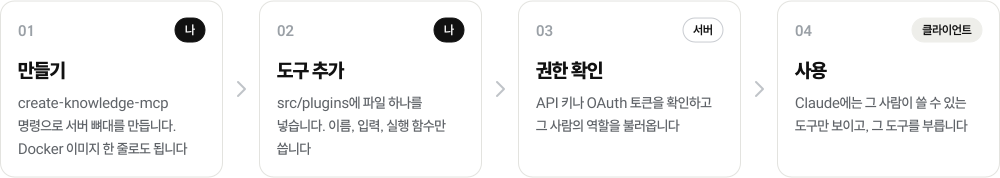

<h1 align="center">
  <picture>
    <source media="(prefers-color-scheme: dark)" srcset=".github/assets/ko/banner-dark.svg">
    
  </picture>
</h1>

<p align="center">
  <a href="LICENSE"></a>
  <a href="#빠른-시작"></a>
  <a href="#클라이언트-연결"></a>
  <a href="#접근-권한"></a>
</p>

<p align="center">
  <b>우리 팀만의 MCP 서버를 만듭니다. 설치는 명령 한 줄, 도구 추가는 파일 하나입니다.</b><br>
  API 키, Google 로그인, 사람별 권한, 호출 기록은 이미 들어 있습니다.<br>
  Google Drive, Slack, GitHub, Railway 연결도 기본으로 들어 있습니다.
</p>

<p align="center">
  <a href="README.md">English</a>&nbsp;&nbsp;|&nbsp;&nbsp;<b>한국어</b>
</p>

<p align="center">
  <a href="#빠른-시작"><b>빠른 시작</b></a>&nbsp;&nbsp;&nbsp;|&nbsp;&nbsp;&nbsp;
  <a href="#도구-추가">도구 추가</a>&nbsp;&nbsp;&nbsp;|&nbsp;&nbsp;&nbsp;
  <a href="#플러그인-api">플러그인 API</a>&nbsp;&nbsp;&nbsp;|&nbsp;&nbsp;&nbsp;
  <a href="#기본-플러그인">기본 플러그인</a>&nbsp;&nbsp;&nbsp;|&nbsp;&nbsp;&nbsp;
  <a href="#접근-권한">접근 권한</a>&nbsp;&nbsp;&nbsp;|&nbsp;&nbsp;&nbsp;
  <a href="#배포">배포</a>
</p>

## 빠른 시작

원하는 쪽을 고릅니다. 두 방법 모두 따로 준비할 데이터베이스가 없습니다. 상태는 로컬 SQLite 파일에 저장합니다.
Node 22.13 이상이나 Docker가 필요합니다.

| 원하는 것 | 시작 방법 |
| --- | --- |
| **내 도구 만들기** (사내 API, 데이터베이스 등 무엇이든) | `npx create-knowledge-mcp my-mcp` |
| **기본 연결만 쓰기** (Drive, Slack, GitHub, Railway) | Docker 이미지 |

**내 도구 만들기**

```bash
npx create-knowledge-mcp my-mcp
cd my-mcp
npm run dev                                                   # http://localhost:8080/mcp, 저장하면 다시 뜸
npm run keys -- create --email you@example.com --role admin   # API 키를 한 번만 보여 줌
```

프로젝트에는 예시 플러그인 `src/plugins/notes.ts`가 들어 있습니다. 클라이언트를 `http://localhost:8080/mcp`에
`Authorization: Bearer <키>`로 연결하면 `notes_add`와 `notes_list`가 보입니다.

**기본 연결만 쓰기**

```bash
docker run -d --name kmcp -p 8080:8080 -v kmcp-data:/data --env-file .env \
  ghcr.io/chanthr/knowledge-mcp:latest
docker exec kmcp knowledge-mcp keys create --email you@example.com --role admin
docker exec kmcp knowledge-mcp doctor        # 어떤 연결이 켜졌는지, 꺼진 연결은 무엇이 빠졌는지
```

환경변수는 [`.env.example`](.env.example)에 모두 있습니다. 각 연결은 자기 환경변수가 채워지면 켜집니다.

## 동작 방식

<p align="center">
  <picture>
    <source media="(prefers-color-scheme: dark)" srcset=".github/assets/ko/flow-dark.svg">
    
  </picture>
</p>

| 구성 | 하는 일 | 직접 쓰나요? |
| --- | --- | --- |
| 코어 | HTTP와 stdio 연결, API 키, Google 로그인 OAuth 2.1, 역할, 호출 기록, 로그 속 비밀값 가리기 | 아니요 |
| 플러그인 | 연결 하나씩 맡습니다. 도구, 필요한 환경변수, 권한 그룹을 정합니다 | 예, 플러그인 하나에 파일 하나 |
| 게⁠이⁠트⁠웨⁠이 | 다른 MCP 서버(GitHub, Notion, 직접 만든 서버)를 이름 접두어를 붙여 대신 엽니다. 기본은 읽기 전용입니다 | 설정만 |
| 저장소 | 키, 사용자, OAuth 토큰, 플러그인 상태, 호출 기록. 기본은 SQLite 파일, Supabase도 됩니다 | 아니요 |

<details>
<summary>요청 하나가 처리되는 순서</summary>
<br>

| 단⁠계 | 주체 | 하는 일 |
| :---: | --- | --- |
| 1 | 클라이언트 | `Authorization: Bearer <API 키 또는 OAuth 토큰>`으로 `/mcp`를 부릅니다. |
| 2 | 코어 | 저장된 해시로 키를 확인하거나 OAuth 토큰을 검증합니다. 그다음 그 사람의 역할과 제한을 불러옵니다. |
| 3 | 코어 | 설정이 끝난 플러그인 중 그 사람에게 허용된 도구만 목록에 올립니다. |
| 4 | 플러그인 | 검증된 입력과 호출한 사람을 받아 일을 하고 글이나 JSON을 돌려줍니다. 호출은 기록됩니다. |

</details>

## 도구 추가

`src/plugins/` 안의 파일 하나가 플러그인 하나입니다. 예시를 복사해 고칩니다.

```ts
// src/plugins/weather.ts
import { definePlugin, defineTool, ToolError, z } from '@chanthr/knowledge-mcp';

export default definePlugin({
  id: 'weather',                    // 권한 그룹 이름도 됩니다
  env: ['WEATHER_API_KEY'],         // 이 값이 없으면 도구가 목록에 나오지 않습니다
  tools: [
    defineTool({
      name: 'weather_now',
      description: '도시의 현재 날씨. 오늘 날씨를 묻는 질문에 씁니다.',
      input: z.object({ city: z.string().describe('도시 이름, 예: Seoul') }),
      annotations: { readOnlyHint: true },
      run: async ({ city }, ctx) => {
        const r = await fetch(`https://api.example.com/weather?q=${encodeURIComponent(city)}`, {
          headers: { Authorization: `Bearer ${process.env.WEATHER_API_KEY}` },
        });
        if (r.status === 404) throw new ToolError(`${city} 라는 도시가 없습니다`);
        ctx.log(`weather for ${city} by ${ctx.user.email}`);
        return r.json();            // JSON 값은 보기 좋은 JSON 글로 나갑니다
      },
    }),
  ],
});
```

파일을 저장하면 개발 서버가 다시 뜹니다. 라우터, 도구 목록, 권한 표는 건드리지 않습니다.

| 코어가 대신 하는 일 | 방법 |
| --- | --- |
| 도구 목록에 올리기 | `name`, `description`, zod `input`(zod 3, 4 모두)을 JSON Schema로 바꿉니다 |
| 설정 전에는 숨기기 | `env`에 적은 값이 모두 채워질 때까지 숨깁니다. `enabled()`를 쓰면 그 조건도 봅니다 |
| 입력 검증 | 잘못된 입력에는 `[invalid_input] 항목: 이유`를 돌려주고 `run`은 부르지 않습니다 |
| 권한 확인 | 플러그인 `id`가 권한 그룹입니다([접근 권한](#접근-권한) 참고) |
| 결과 모양 맞추기 | 문자열은 글로, 그 밖의 값은 JSON 글로 보냅니다. MCP 결과 형식은 그대로 보냅니다 |
| 오류 처리 | `throw new ToolError('...')`는 `[error] ...`, 그 밖의 오류는 `[fatal] ...`로 돌려줍니다 |
| 호출 기록 | 도구, 사람, 역할, 성공 여부, 걸린 시간을 남깁니다. 입력값은 남기지 않습니다 |

## 플러그인 API

모두 `@chanthr/knowledge-mcp`에서 가져옵니다.

<details open>
<summary><code>definePlugin({...})</code></summary>
<br>

| 항목 | 형식 | 뜻 |
| --- | --- | --- |
| `id` | `string` | 영문 소문자, 숫자, 대시. 권한 그룹이자 설정 키입니다 |
| `description` | `string` | `knowledge-mcp doctor`에 나오는 한 줄 설명 |
| `env` | `string[]` | 플러그인을 켜는 데 모두 필요한 환경변수 |
| `enabled` | `() => true \| string` | 추가 조건. 꺼 둘 이유를 문자열로 돌려주면 `doctor`에 그대로 나옵니다 |
| `tools` | `Tool[]` | `defineTool`로 만든 도구 |
| `upstreams` | `UpstreamSpec[]` 또는 함수 | 이 플러그인 그룹에 넣을 원격 MCP 서버([원격 MCP 서버](#원격-mcp-서버) 참고) |
| `instructions` | `string` | 클라이언트가 연결할 때 받는 사용 안내에 덧붙일 글 |
| `configSchema` | zod 스키마 | `mcp.config.json`의 `plugins.<id>`를 검증합니다. 결과가 `ctx.config`입니다 |
| `start` | `(ctx) => void` | HTTP 서버가 뜬 뒤 한 번 실행합니다. 백그라운드 작업용입니다. stdio에서는 실행하지 않습니다 |
| `commands` | `{ [이름]: { description, run(args) } }` | 명령줄 명령: `knowledge-mcp <id> <이름> [인자]` |

</details>

<details open>
<summary><code>defineTool({...})</code>과 ctx</summary>
<br>

| 항목 | 형식 | 뜻 |
| --- | --- | --- |
| `name` | `string` | 영문 소문자, 숫자, 밑줄. 모든 플러그인을 통틀어 겹치면 안 됩니다. `ping`은 예약어입니다 |
| `description` | `string` | 무엇을 하고 언제 쓰는지. 모델이 이 글을 보고 도구를 고릅니다 |
| `input` | zod 객체 | 입력 항목. 항목마다 `.describe()`로 설명을 붙입니다. 입력이 없으면 생략합니다 |
| `annotations` | `ToolAnnotations` | `readOnlyHint`, `destructiveHint` 같은 MCP 힌트 |
| `enabled` | `() => true \| string` | 이 도구 하나에만 거는 조건 |
| `run` | `(input, ctx) => 값` | 검증된 입력과 아래 ctx를 받습니다 |

| `ctx.` | 뜻 |
| --- | --- |
| `user` | `{ email, role, keyId }`. 역할은 `admin`, `member`, `viewer` 중 하나입니다 |
| `state` | `get(key)`, `set(key, value)`, `delete(key)`. 플러그인별로 저장소에 남아 재시작해도 유지됩니다 |
| `config` | `mcp.config.json`의 `plugins.<id>` 부분 |
| `log(...)` | 플러그인 이름을 붙여 stderr에 씁니다. 비밀값은 가려집니다. stdio에서는 `console.log`를 쓰지 않습니다 |
| `auth` | 전체 인증 정보. Slack 채널과 Drive 폴더 제한도 들어 있습니다 |

</details>

<details>
<summary><code>server.ts</code>와 플러그인 불러오기</summary>
<br>

만든 프로젝트에는 시작 파일이 하나 있습니다. 이 파일이 명령줄 역할도 해서, 모든 명령이 내 플러그인을 압니다.

```ts
import { run, builtinPlugins, loadPlugins } from '@chanthr/knowledge-mcp';

const mine = await loadPlugins(new URL('./plugins/', import.meta.url));
await run({ plugins: [...builtinPlugins, ...mine] });
```

`loadPlugins`는 폴더 안의 `.ts`, `.js` 파일을 이름 순서로 불러옵니다. `_`로 시작하는 파일, `.d.ts`, 시험 파일은
건너뜁니다. 기본 연결을 빼려면 `builtinPlugins`를 빼거나, `drivePlugin`, `slackPlugin`, `githubPlugin`,
`railwayPlugin` 중 필요한 것만 넣습니다.

</details>

## 명령줄

`knowledge-mcp` 명령, Docker 이미지, 직접 만든 `server.ts` 모두 같은 명령을 받습니다.

| 명령 | 하는 일 |
| --- | --- |
| `serve` | `$PORT`(기본 8080)에서 HTTP 서버를 띄웁니다. `serve --stdio`는 표준 입출력으로 대화합니다 |
| `keys create [--email E] [--role R] [--label L] [--expires 90d]` | API 키를 만들고 한 번만 보여 줍니다. 해시만 저장합니다 |
| `keys list` / `keys revoke <id>` | 키 목록을 봅니다(키 값은 나오지 않음). 또는 키 하나를 끕니다 |
| `users add <email> [--role admin\|member] [--tools a,b]` | 사람을 등록합니다. `--tools`를 주면 멤버는 그 플러그인만 씁니다 |
| `users list` / `users remove <email>` | 등록된 사람을 보거나 지웁니다 |
| `doctor` | 설정 위치, 저장소, OAuth, 플러그인별 켜짐 여부와 꺼진 이유 |
| `<플러그인> <명령>` | 플러그인 명령. 예: `drive reindex --dry-run`, `slack channels` |

## 기본 플러그인

환경변수가 채워지면 켜집니다. 기본 도구는 모두 읽기만 합니다.

| 플러그인 | 도구 | 필요한 것 |
| --- | --- | --- |
| `drive` | `search_drive`, `read_drive_file`, `list_drive_folder` | Google 서비스 계정이나 OAuth refresh token, 설정의 `drive.roots` |
| `drive` | `semantic_search_drive` | `QDRANT_URL`, `OPENAI_API_KEY`, 색인(`knowledge-mcp drive reindex`) |
| `slack` | `slack_list_channels`, `slack_read_channel`, `slack_find_files`, `slack_get_file` | `SLACK_BOT_TOKEN`(`xoxb-`). 봇은 초대받은 채널만 봅니다 |
| `slack` | `slack_search` | `SLACK_USER_TOKEN`(`xoxp-`)도 필요합니다. 결과는 봇이 들어간 채널로 거릅니다 |
| `github` | `repo_tree`, GitHub 원격 MCP 도구 `github_*`(읽기 전용) | Contents 읽기 권한이 있는 `GITHUB_TOKEN` |
| `railway` | `railway_services`, `railway_deployments`, `railway_logs`(로그 속 비밀값은 가림) | `RAILWAY_TOKEN` |
| 코어 | `ping` | 없음. 내가 누구로 접속했는지, 어떤 플러그인이 켜졌는지 보여 줍니다 |

<details>
<summary>의미 검색용 Drive 색인</summary>
<br>

| 작업 | 방법 |
| --- | --- |
| 처음 전체 색인 | `knowledge-mcp drive reindex` (`docker compose run --rm knowledge-mcp drive reindex`) |
| 최신 상태 유지 | HTTP 서버가 30분마다 Drive 변경분을 반영합니다(`DRIVE_SYNC_INTERVAL_MIN`). 전체 색인을 먼저 합니다 |
| 정리 | 전체 실행은 목록에서 빠진 파일의 벡터를 지웁니다. 제외 폴더로 옮긴 파일이 여기에 해당합니다 |
| 처음부터 다시 | `--recreate`는 컬렉션을 비우고 시작합니다. `--dry-run`은 청크 수만 셉니다 |

| 형식 | 글을 뽑는 방법 |
| --- | --- |
| Markdown, 일반 텍스트 | 그대로 |
| Google 문서, 슬라이드 | Drive 내보내기 |
| Google 스프레드시트 | Drive에서 CSV로 내보냅니다. 첫 시트만 읽습니다 |
| Word, PowerPoint, Excel, 글자가 든 PDF | 서버 안의 파서 |
| 스캔 PDF, PNG, JPEG, WebP | Mathpix OCR. `MATHPIX_APP_ID`, `MATHPIX_APP_KEY`가 있을 때만 |

`DRIVE_MAX_FILE_BYTES`(기본 50MB)보다 큰 파일은 읽거나 색인하지 않습니다. 임베딩은 OpenAI
`text-embedding-3-small`을 씁니다.

</details>

<details>
<summary>Slack 채널 용도표</summary>
<br>

`slack_list_channels`는 채널마다 무슨 용도인지 모델에게 알려 줍니다. 새 채널은 꺼진 채로 추가됩니다.
`knowledge-mcp slack channel '#dev' --purpose "배포와 장애" --on`으로 용도를 적고 켭니다.
목록은 `knowledge-mcp slack channels`로 봅니다.

</details>

## 설정

| 층 | 위치 | 내용 |
| --- | --- | --- |
| 비⁠밀⁠값 | 환경변수(로컬은 `.env`, 운영은 호스트 환경변수) | 키와 토큰. [`.env.example`](.env.example)에 모두 있습니다 |
| 볼⁠ ⁠대⁠상 | `mcp.config.json` | Drive 폴더, 제외 폴더, 로그인 허용 목록, viewer 권한, 플러그인 설정, 원격 MCP 서버. [`mcp.config.example.json`](mcp.config.example.json) 참고 |

`.env`와 `mcp.config.json`은 현재 폴더를 먼저 보고, 없으면 프로젝트 폴더를 봅니다. 클라이언트가 다른 폴더에서
서버를 띄워도 찾습니다. `MCP_CONFIG_JSON`(내용 직접)과 `MCP_CONFIG_PATH`가 있으면 그쪽이 먼저입니다.

| 설정 키 | 뜻 |
| --- | --- |
| `orgId` | 인증 정보에 실리는 조직 식별자 |
| `branding.name` / `branding.instructions` | 서버 이름. `instructions`를 적으면 자동 안내(기본 문장과 플러그인별 안내)를 대신합니다 |
| `drive.roots[]` / `drive.excludeFolders[]` | 색인하고 검색할 폴더, 어디서든 건너뛸 폴더 이름 |
| `qdrant.collection` | 벡터 컬렉션 이름(환경변수 `QDRANT_COLLECTION`이 먼저) |
| `oauth.allowedDomains[]` / `oauth.allowedEmails[]` | Google 로그인을 허용할 대상 |
| `access.viewerTools[]` | 등록되지 않은 로그인 사용자에게 열 플러그인 id. 기본은 없음 |
| `plugins.<id>` | 플러그인 하나의 설정. `ctx.config`로 들어갑니다 |
| `upstreams[]` | 원격 MCP 서버(다음 절) |
| `data.schema` | 서버 표를 둘 Supabase 스키마(Supabase 저장소일 때만) |

<details>
<summary>저장소: SQLite 또는 Supabase</summary>
<br>

| 저장소 | 언제 | 준비 |
| --- | --- | --- |
| SQLite(기본) | 서버 하나, 기계 하나 | 없음. 파일은 `<데이터 폴더>/knowledge-mcp.db`입니다(`MCP_DATA_DIR`, Docker는 `/data`). 소유자만 읽게 만듭니다(0600) |
| Supabase | 상태를 공용 Postgres에 두고 화면으로 보고 싶을 때 | [`sql/supabase.sql`](packages/knowledge-mcp/sql/supabase.sql)을 실행하고(업그레이드마다 다시), `SUPABASE_URL`, `SUPABASE_SERVICE_ROLE_KEY`를 넣습니다 |

Supabase 변수 두 개가 다 있으면 Supabase를 씁니다. `MCP_STORE=sqlite|supabase`로 정할 수도 있습니다.

</details>

### 원격 MCP 서버

서버는 게이트웨이도 됩니다. 다른 MCP 서버를 적으면 그 도구가 접두어를 달고 나타나고, 내 키와 권한 뒤에 놓입니다.

```json
{
  "upstreams": [
    {
      "name": "notion",
      "url": "https://mcp.example.com/mcp",
      "tokenEnv": "NOTION_MCP_TOKEN",
      "expose": "read"
    }
  ]
}
```

| 항목 | 뜻 |
| --- | --- |
| `name` | 권한 그룹이자 로그에 쓰는 이름 |
| `prefix` | 도구 이름 접두어. 기본 `<name>_` |
| `tokenEnv` | bearer 토큰이 든 환경변수 이름. 토큰 자체는 설정 파일에 넣지 않습니다 |
| `expose` | `"read"`(기본)는 첫 단어가 `get`, `list`, `search` 같은 읽기 동사인 도구만 엽니다. `"all"`은 전부 엽니다. 목록을 주면 그 이름만 엽니다 |

원격 도구와 이름이 같은 로컬 도구가 있으면 로컬 도구가 이기고 원격 도구는 숨깁니다.

## 접근 권한

**누구인지**는 API 키나 Google 로그인으로 정합니다. **무엇을 쓸 수 있는지**는 사용자 등록 정보로 정합니다.

| 등록 정보 | 역할 | 쓸 수 있는 것 |
| --- | --- | --- |
| `--role admin` | admin | 모든 도구 |
| `--role member` | member | 모든 플러그인. `--tools`를 주면 그 플러그인만 씁니다. Drive 폴더와 Slack 채널도 제한할 수 있습니다 |
| 등록 안 됨 | viewer | `ping`, 그리고 `access.viewerTools`에 적은 플러그인만 |

```bash
knowledge-mcp users add lee@example.com --role member --tools drive,notes
knowledge-mcp keys create --email lee@example.com --expires 90d
```

<details>
<summary>API 키</summary>
<br>

1. 키는 `kmcp_…` 모양이고 SHA-256 해시로만 저장합니다. 키는 만들 때 한 번만 보여 줍니다.
2. 이메일이 붙은 키는 그 사람의 등록 정보에서 역할을 가져옵니다. 등록을 지우면 키 권한도 내려갑니다.
   이메일이 없는 키는 자기 역할을 가진 서비스 키입니다.
3. `keys revoke <id>`는 `AUTH_CACHE_TTL_MS`(기본 60초) 안에 반영됩니다.
4. 인증 실패는 클라이언트 IP마다 횟수를 제한합니다. 실제 IP를 보려면 프록시 구성에 맞게 `TRUST_PROXY`를 정합니다.
5. stdio는 `MCP_API_KEY`가 없으면 로컬 관리자로 돕니다. 프로세스를 띄운 사람이 이미 모든 토큰을 쥐고 있기 때문입니다.

</details>

<details>
<summary>Claude 웹, 데스크톱 커넥터용 OAuth</summary>
<br>

OAuth 환경변수와 허용 목록을 넣으면 Google로 로그인하는 OAuth 2.1 서버가 켜집니다. 토큰을 내주기 전에
어떤 앱이 어디로 토큰을 받는지 동의 화면으로 보여 줍니다. 자세한 안내는 [`OAUTH_SETUP.md`](OAUTH_SETUP.md)에 있습니다.

</details>

## 배포

| 대상 | 방법 |
| --- | --- |
| 기본 연결 | `ghcr.io/chanthr/knowledge-mcp`(`latest`는 최신 릴리스, `x.y.z`, `edge`는 `main`). [`compose.yaml`](compose.yaml)이 데이터 볼륨과 함께 띄웁니다 |
| 직⁠접⁠ ⁠만⁠든⁠ ⁠프⁠로⁠젝⁠트 | 만들어진 `Dockerfile`로 `docker build` 하고 `/data`에 볼륨을 붙여 실행합니다 |
| Railway | [`railway.toml`](railway.toml). `/data`에 볼륨을 붙이거나 `MCP_STORE=supabase`를 씁니다 |

1. **HTTPS.** 원격 클라이언트를 붙이기 전에 HTTPS 뒤에 둡니다. OAuth 발급자는 `https`여야 합니다.
2. **인스턴스 하나.** 세션과 진행 중인 로그인은 메모리에 있고, SQLite는 파일 하나입니다. 한 대만 띄웁니다.
3. **`/data` 유지.** 볼륨이 없으면 재배포 때 키와 사용자가 사라집니다.

## 클라이언트 연결

| 클라이언트 | 방법 |
| --- | --- |
| C⁠l⁠a⁠u⁠d⁠e⁠ ⁠C⁠o⁠d⁠e⁠,⁠ ⁠로⁠컬 | `claude mcp add my-mcp -- node /절대경로/my-mcp/dist/server.js serve --stdio` |
| C⁠l⁠a⁠u⁠d⁠e⁠ ⁠C⁠o⁠d⁠e⁠,⁠ ⁠원⁠격 | `claude mcp add --transport http my-mcp https://<호스트>/mcp --header "Authorization: Bearer <키>"` |
| C⁠l⁠a⁠u⁠d⁠e⁠ ⁠웹⁠,⁠ ⁠데⁠스⁠크⁠톱 | OAuth를 켜고 `https://<호스트>/mcp`로 커스텀 커넥터를 추가합니다 |
| 다⁠른⁠ ⁠M⁠C⁠P⁠ ⁠클⁠라⁠이⁠언⁠트 | 주소 `https://<호스트>/mcp`, 헤더 `Authorization: Bearer <키>` |

## 0.2에서 올리기

| 바뀐 점 | 할 일 |
| --- | --- |
| Supabase가 선택이 되고 SQLite가 기본입니다 | `SUPABASE_*`가 있는 기존 설치는 계속 Supabase를 씁니다. [`sql/supabase.sql`](packages/knowledge-mcp/sql/supabase.sql)을 한 번 다시 실행합니다. `mcp_plugin_state` 표를 만들고 Drive 동기화 토큰을 옮깁니다 |
| 스크립트가 명령줄로 옮겨졌습니다 | `npm run reindex`는 `knowledge-mcp drive reindex`가 됩니다. 이미지 진입점은 `node dist/index.js` 대신 `knowledge-mcp`(기본 `serve`)입니다 |
| 역할 `engineer`가 `member`가 됐습니다 | 기존 값은 그대로 동작합니다. `access.viewerTools`와 `allowed_tools`에는 어떤 플러그인 id든 씁니다 |
| `MCP_API_KEY` 없는 stdio | 시작을 거부하지 않고 로컬 관리자로 돕니다 |
| 깨진 `mcp.config.json` | 기본값으로 조용히 넘어가지 않고 파싱 오류를 보여 주며 멈춥니다 |

## 보안 참고

1. `.env`, 서비스 계정 JSON, `mcp.config.json`, `data/`는 커밋하지 않습니다. 모두 gitignore와 이미지 제외 목록에 있습니다.
2. 데이터 파일에는 키 해시와 OAuth 클라이언트 비밀값이 있습니다. 소유자만 읽게 만들어지니 볼륨도 비공개로 둡니다.
3. 기본 플러그인은 Drive, Slack, GitHub, Railway를 바꾸지 않습니다. 게이트웨이는 `expose`를 바꿀 때만 원격 쓰기 도구를 엽니다.
4. Drive 색인은 임베딩을 위해 문서 본문을 OpenAI로 보냅니다. OCR을 켜면 스캔 파일을 Mathpix로 보냅니다.
5. 토큰은 자기가 읽을 수 있는 곳까지 닿습니다. Slack 봇, GitHub 토큰, Railway 토큰은 모든 사용자가 봐도 되는 범위로만 줍니다.

## 파일 구성

| 경로 | 내용 |
| --- | --- |
| [`packages/knowledge-mcp/src/plugin/`](packages/knowledge-mcp/src/plugin/) | 플러그인 API: `definePlugin`, `defineTool`, 등록부, 불러오기, 결과 모양 맞추기 |
| [`packages/knowledge-mcp/src/core/`](packages/knowledge-mcp/src/core/) | 인증, OAuth, 권한, 설정, 게이트웨이, 로그 가리기 |
| [`packages/knowledge-mcp/src/server/`](packages/knowledge-mcp/src/server/) | HTTP와 stdio 연결, MCP 요청 처리, 사용자 역할 계산 |
| [`packages/knowledge-mcp/src/store/`](packages/knowledge-mcp/src/store/) | 저장소 인터페이스, SQLite와 Supabase 구현 |
| [`packages/knowledge-mcp/src/plugins/`](packages/knowledge-mcp/src/plugins/) | 기본 플러그인: `drive`, `slack`, `github`, `railway` |
| [`packages/knowledge-mcp/src/run.ts`](packages/knowledge-mcp/src/run.ts) | 명령줄 |
| [`packages/knowledge-mcp/test/`](packages/knowledge-mcp/test/) | 단위 시험, HTTP와 stdio 종단 시험 |
| [`packages/create-knowledge-mcp/`](packages/create-knowledge-mcp/) | 생성기와 프로젝트 템플릿 |
| [`scripts/smoke-create.sh`](scripts/smoke-create.sh) | 묶기, 생성, 설치, 빌드, 서버 실행, 호출까지 한 번에 확인 |
| [`Dockerfile`](Dockerfile), [`compose.yaml`](compose.yaml), [`railway.toml`](railway.toml) | 이미지, 로컬 실행, Railway |
| [`.github/`](.github/) | CI, 이미지와 npm 워크플로, 이슈와 PR 양식, README 그림(`assets/make.py`) |

개발할 때는 `npm install`, `npm test`(단위와 종단), `npm run typecheck`, `npm run smoke:create`를 씁니다.

## 기여

문제와 아이디어는 이슈로 남겨 주세요.

| 양식 | 이럴 때 씁니다 |
| --- | --- |
| [**버그 제보**](https://github.com/chanthr/internal-mcp/issues/new?template=01-bug.yml) | 코드나 문서와 다르게 동작할 때 |
| [**개선 제안**](https://github.com/chanthr/internal-mcp/issues/new?template=02-improvement.yml) | 더 나은 방법이 있거나 문서가 코드와 맞지 않을 때 |

이 저장소는 공개입니다. 이슈와 PR에 API 키, 토큰, 내부 주소, 비공개 문서를 넣지 마세요. 보안 문제는 이슈 대신
Security 탭의 [**Report a vulnerability**](https://github.com/chanthr/internal-mcp/security/advisories/new)로 비공개 제보해 주세요.

## 라이선스

[MIT](LICENSE) © chanthr
