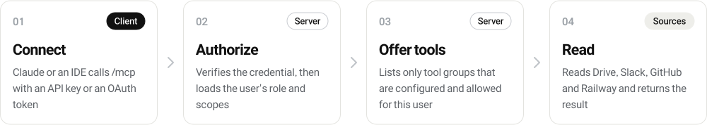

<h1 align="center">
  <picture>
    <source media="(prefers-color-scheme: dark)" srcset=".github/assets/banner-dark.svg">
    
  </picture>
</h1>

<p align="center">
  <a href="LICENSE"></a>
  <a href="#quick-start"></a>
  <a href="#connect-a-client"></a>
  <a href="#access-control"></a>
</p>

<p align="center">
  <b>Build your team's own MCP server. Install with one command, add a tool with one file.</b><br>
  API keys, Google sign-in, per-person permissions and an audit log are already done.<br>
  Google Drive, Slack, GitHub and Railway come built in.
</p>

<p align="center">
  <b>English</b>&nbsp;&nbsp;|&nbsp;&nbsp;<a href="README.ko.md">한국어</a>
</p>

<p align="center">
  <a href="#quick-start"><b>Quick start</b></a>&nbsp;&nbsp;&nbsp;|&nbsp;&nbsp;&nbsp;
  <a href="#add-a-tool">Add a tool</a>&nbsp;&nbsp;&nbsp;|&nbsp;&nbsp;&nbsp;
  <a href="#plugin-api">Plugin API</a>&nbsp;&nbsp;&nbsp;|&nbsp;&nbsp;&nbsp;
  <a href="#built-in-plugins">Built-in plugins</a>&nbsp;&nbsp;&nbsp;|&nbsp;&nbsp;&nbsp;
  <a href="#access-control">Access control</a>&nbsp;&nbsp;&nbsp;|&nbsp;&nbsp;&nbsp;
  <a href="#deploy">Deploy</a>
</p>

## Quick start

Pick the path that matches what you want. Both start with no database to set up: state lives in a local
SQLite file. You need Node 22.13 or later, or Docker.

| You want | Start with |
| --- | --- |
| **Your own tools** (internal APIs, databases, anything) | `npx create-knowledge-mcp my-mcp` |
| **Only the built-in connectors** (Drive, Slack, GitHub, Railway) | The Docker image |

**Your own tools**

```bash
npx create-knowledge-mcp my-mcp
cd my-mcp
npm run dev                                                   # http://localhost:8080/mcp, reloads on save
npm run keys -- create --email you@example.com --role admin   # prints an API key once
```

The project comes with an example plugin, `src/plugins/notes.ts`. Point a client at
`http://localhost:8080/mcp` with `Authorization: Bearer <key>` and you will see `notes_add` and `notes_list`.

**Only the built-in connectors**

```bash
cp .env.example .env                         # fill in the connectors you want
cp mcp.config.example.json mcp.config.json   # Drive folders, excluded folders, sign-in allowlist
docker run -d --name kmcp -p 8080:8080 -v kmcp-data:/data --env-file .env \
  -v "$PWD/mcp.config.json:/app/mcp.config.json:ro" ghcr.io/chanthr/knowledge-mcp:latest
docker exec kmcp knowledge-mcp keys create --email you@example.com --role admin
docker exec kmcp knowledge-mcp doctor        # which connectors are on, and what each one is missing
```

[`.env.example`](.env.example) lists every variable. Each connector turns on when its variables are set.
The image holds no config: mount `mcp.config.json` as above, or pass it inline with `-e MCP_CONFIG_JSON='{…}'`.
[`compose.yaml`](compose.yaml) does the same with Docker Compose.

## How it works

<p align="center">
  <picture>
    <source media="(prefers-color-scheme: dark)" srcset=".github/assets/flow-dark.svg">
    
  </picture>
</p>

| Part | What it does | You write it? |
| --- | --- | --- |
| Core | HTTP and stdio transports, API keys, OAuth 2.1 with Google sign-in, roles, audit log, secret masking in logs | No |
| Plugins | One connector each: its tools, the env vars it needs, its permission group | Yes, one file per plugin |
| Gateway | Proxies other MCP servers (GitHub's, Notion's, yours) under a name prefix, read-only by default | Config only |
| Store | Keys, users, OAuth tokens, plugin state, audit log. SQLite file by default, Supabase optional | No |

<details>
<summary>What happens on each request</summary>
<br>

| Step | Who | What happens |
| :---: | --- | --- |
| 1 | Client | Calls `/mcp` with `Authorization: Bearer <API key or OAuth access token>`. |
| 2 | Core | Checks the key against its stored hash, or verifies the OAuth token, then loads the person's role and limits. |
| 3 | Core | Lists only tools whose plugin is configured and that the person's role allows. |
| 4 | Plugin | Gets validated input and the caller, does the work, returns text or JSON. The call is logged. |

</details>

## Add a tool

Every file in `src/plugins/` is a plugin. Copy the example and edit it:

```ts
// src/plugins/weather.ts
import { definePlugin, defineTool, ToolError, z } from '@chnxthr/knowledge-mcp';

export default definePlugin({
  id: 'weather',                    // also the permission group
  env: ['WEATHER_API_KEY'],         // the tools stay hidden until this is set
  tools: [
    defineTool({
      name: 'weather_now',
      description: 'Current weather for a city. Use it for questions about today’s weather.',
      input: z.object({ city: z.string().describe('City name, e.g. Seoul') }),
      annotations: { readOnlyHint: true },
      run: async ({ city }, ctx) => {
        const r = await fetch(`https://api.example.com/weather?q=${encodeURIComponent(city)}`, {
          headers: { Authorization: `Bearer ${process.env.WEATHER_API_KEY}` },
        });
        if (r.status === 404) throw new ToolError(`No city named ${city}`);
        ctx.log(`weather for ${city} by ${ctx.user.email}`);
        return r.json();            // any JSON value is sent as pretty JSON
      },
    }),
  ],
});
```

Save the file and the dev server restarts. New files in `src/plugins/` are picked up too. You did not touch a
router, a tool list or a permission table.

| The core does this for you | How |
| --- | --- |
| Lists the tool | From `name`, `description` and the zod `input` (zod 3 or 4), turned into JSON Schema |
| Hides it when not configured | Until every name in `env` is set, and `enabled()` returns true when you add one |
| Validates input | Bad input returns `[invalid_input] tool '<name>': field: reason` to the model, and `run` is not called |
| Checks permission | The plugin `id` is the permission group (see [Access control](#access-control)) |
| Formats the result | A string becomes text, any other value becomes pretty JSON, an MCP result passes through |
| Handles errors | `throw new ToolError('...')` returns `[error] ...`. Any other error returns `[fatal] ...` |
| Logs the call | Tool, person, role, success and duration go to the audit log. Arguments are not stored |

## Plugin API

Everything is exported from `@chnxthr/knowledge-mcp`.

<details open>
<summary><code>definePlugin({...})</code></summary>
<br>

| Field | Type | Meaning |
| --- | --- | --- |
| `id` | `string` | Lowercase letters, digits and dashes. Permission group and config key |
| `description` | `string` | One line shown by `knowledge-mcp doctor` |
| `env` | `string[]` | Env vars that must all be set for the plugin to turn on |
| `enabled` | `() => true \| string` | Extra condition. Return a reason string to stay off; `doctor` shows it |
| `tools` | `Tool[]` | Tools made with `defineTool` |
| `upstreams` | `UpstreamSpec[]` or a function | Remote MCP servers whose tools join this plugin's group (see [Gateway](#remote-mcp-servers)) |
| `instructions` | `string` | Usage notes added to what the client receives on connect |
| `configSchema` | zod schema | Validates `plugins.<id>` in `mcp.config.json`; the result is `ctx.config` |
| `start` | `(ctx) => void` | Runs once after the HTTP server listens. For background jobs. Not run in stdio mode |
| `commands` | `{ [name]: { description, run(args) } }` | CLI commands: `knowledge-mcp <id> <name> [args]` |

</details>

<details open>
<summary><code>defineTool({...})</code> and the context</summary>
<br>

| Field | Type | Meaning |
| --- | --- | --- |
| `name` | `string` | Lowercase letters, digits and underscores. Unique across all plugins; `ping` is reserved |
| `description` | `string` | What it does and when to use it. The model picks tools by this |
| `input` | zod object | Arguments. Describe each field with `.describe()`. Omit for no arguments |
| `annotations` | `ToolAnnotations` | MCP hints such as `readOnlyHint` and `destructiveHint` |
| `enabled` | `() => true \| string` | Extra condition for this one tool |
| `run` | `(input, ctx) => value` | Gets the parsed input and the context below |

| `ctx.` | Meaning |
| --- | --- |
| `user` | `{ email, role, keyId }`. Role is `admin`, `member` or `viewer` |
| `state` | `get(key)`, `set(key, value)`, `delete(key)`. Kept per plugin in the store, so it survives restarts |
| `config` | This plugin's `plugins.<id>` section of `mcp.config.json` |
| `log(...)` | Writes to stderr with the plugin name. Secrets are masked. Never use `console.log` in stdio mode |
| `auth` | The full auth context, including Slack channel and Drive folder limits |

</details>

<details>
<summary>Your <code>server.ts</code> and loading plugins</summary>
<br>

A generated project has one entry file. It is also the command line, so every command sees your plugins.

```ts
import { run, builtinPlugins, loadPlugins } from '@chnxthr/knowledge-mcp';

const mine = await loadPlugins(new URL('./plugins/', import.meta.url));
await run({ plugins: [...builtinPlugins, ...mine] });
```

`loadPlugins` imports every `.ts` and `.js` file in the folder in name order. It skips names starting with `_`,
`.d.ts` files and tests. Leave out `builtinPlugins`, or pick from `drivePlugin`, `slackPlugin`, `githubPlugin`
and `railwayPlugin`, to ship fewer connectors.

</details>

## CLI

The `knowledge-mcp` binary, the Docker image entrypoint, and your own `server.ts` all take these commands.

| Command | What it does |
| --- | --- |
| `serve` | Starts the HTTP server on `$PORT` (default 8080). `serve --stdio` talks over stdin and stdout instead |
| `keys create [--email E] [--role R] [--label L] [--expires 90d]` | Creates an API key and prints it once. Only its hash is stored |
| `keys list` / `keys revoke <id>` | Lists keys (never the key itself) or deactivates one |
| `users add <email> [--role admin\|member] [--tools a,b]` | Registers a person. `--tools` limits a member to those plugins |
| `users list` / `users remove <email>` | Shows or removes people |
| `doctor` | Config source, store, OAuth, and each plugin on or off with the reason |
| `<plugin> <command>` | A plugin command, e.g. `drive reindex --dry-run` or `slack channels` |

## Built-in plugins

Each turns on when its env vars are set. All built-in tools only read.

| Plugin | Tools | Needs |
| --- | --- | --- |
| `drive` | `search_drive`, `read_drive_file`, `list_drive_folder` | A Google service account or OAuth refresh token, and `drive.roots` in the config |
| `drive` | `semantic_search_drive` | `QDRANT_URL`, `OPENAI_API_KEY` and an index (`knowledge-mcp drive reindex`) |
| `slack` | `slack_list_channels`, `slack_read_channel`, `slack_find_files`, `slack_get_file` | `SLACK_BOT_TOKEN` (`xoxb-`). The bot sees only channels it was invited to |
| `slack` | `slack_search` | `SLACK_USER_TOKEN` (`xoxp-`) as well. Results are limited to the bot's channels |
| `github` | `repo_tree`, plus GitHub's remote MCP tools as `github_*` (read-only) | `GITHUB_PAT` (or `GITHUB_TOKEN`) with Contents: read |
| `railway` | `railway_services`, `railway_deployments`, `railway_logs` (secrets in logs are masked) | `RAILWAY_TOKEN` |
| core | `ping` | Nothing. Shows who you are and which plugins are on |

<details>
<summary>Drive indexing for semantic search</summary>
<br>

| Task | How |
| --- | --- |
| First full index | `knowledge-mcp drive reindex` (`docker compose run --rm knowledge-mcp drive reindex`) |
| Keep it fresh | The HTTP server syncs Drive changes every 30 minutes (`DRIVE_SYNC_INTERVAL_MIN`). Do the full index first |
| Clean up | A full run deletes vectors of files no longer listed, such as files moved into an excluded folder |
| Start over | `--recreate` empties the collection first. `--dry-run` only counts chunks. It skips OCR, so it never charges Mathpix |

| Format | How text is extracted |
| --- | --- |
| Markdown, plain text | As is |
| Google Docs, Slides | Drive export |
| Google Sheets | Drive export as CSV. Only the first sheet |
| Word, PowerPoint, Excel, PDF with text | Local parsers |
| Scanned PDF, PNG, JPEG, WebP | Mathpix OCR, only when `MATHPIX_APP_ID` and `MATHPIX_APP_KEY` are set |

Files larger than `DRIVE_MAX_FILE_BYTES` (50 MB by default) are not read or indexed. Embeddings use OpenAI
`text-embedding-3-small`.

</details>

<details>
<summary>Slack channel map</summary>
<br>

`slack_list_channels` tells the model what each channel is for.

1. Invite the bot to the channels it should read, then call `slack_list_channels` once from a client. That call
   copies the channel list from Slack into the map. New channels arrive switched off.
2. Describe a channel and switch it on: `knowledge-mcp slack channel '#dev' --purpose "Deploys and incidents" --on`.
   List the map with `knowledge-mcp slack channels`.

On and off only decide what `slack_list_channels` shows by default. They do not grant or block reading:
that depends on the bot's channels and on each person's allowed channels.

</details>

## Configuration

| Layer | Where | What |
| --- | --- | --- |
| Secrets | Env vars (`.env` locally, host env in production) | Keys and tokens. [`.env.example`](.env.example) lists them all |
| What to look at | `mcp.config.json` | Drive folders, exclusions, sign-in allowlist, viewer access, plugin settings, remote MCP servers. See [`mcp.config.example.json`](mcp.config.example.json) |

`.env` and `mcp.config.json` are read from the working directory first, then from your project folder, so a
client that starts the server from elsewhere still finds them. `MCP_CONFIG_JSON` (inline) and
`MCP_CONFIG_PATH` override the file. The config is read once at startup: restart the server after you change
it, the sign-in allowlist included.

| Config key | Meaning |
| --- | --- |
| `orgId` | Organization identifier carried in the auth context |
| `branding.name` / `branding.instructions` | Name shown on the sign-in consent page and in OAuth metadata. `instructions` replaces the guide the client receives (base line plus each plugin's notes) |
| `drive.roots[]` | `{ id, name, source }` folders to index and search. `source` is `dev` (Markdown with frontmatter) or `biz` (PDF, Office and Google files) |
| `drive.excludeFolders[]` | Folder names skipped everywhere: index, search, read and list. Case and spacing are ignored |
| `drive.customerFolders[]` | Top-level `biz` folders with one subfolder per customer (`Clients/Acme/…` → customer `Acme`), for the `customer` search filter. Default `Clients`, `Customers`, `고객사` |
| `drive.rank[]` | Optional `{ prefix, label, weight }` rules for `semantic_search_drive`, e.g. prefer `Current/` (weight 1.1) over `Archive/` (0.9). Default: none |
| `qdrant.collection` | Vector collection name (env `QDRANT_COLLECTION` overrides) |
| `oauth.allowedDomains[]` / `oauth.allowedEmails[]` | Who may sign in with Google |
| `access.viewerTools[]` | Plugin ids open to signed-in people without a users entry. Default: none |
| `plugins.<id>` | Settings for one plugin, passed as `ctx.config` |
| `upstreams[]` | Remote MCP servers (next section) |
| `data.schema` | Supabase schema for the server's tables (Supabase store only) |

<details>
<summary>Store: SQLite or Supabase</summary>
<br>

| Store | When | Setup |
| --- | --- | --- |
| SQLite (default) | One server, one machine | Nothing. The file is `<data dir>/knowledge-mcp.db` (`MCP_DATA_DIR`, `/data` in Docker). Created owner-only (0600) |
| Supabase | State in a shared Postgres you can browse | Run [`sql/supabase.sql`](packages/knowledge-mcp/sql/supabase.sql) (again after every upgrade), set `SUPABASE_URL` and `SUPABASE_SERVICE_ROLE_KEY` |

Setting both Supabase variables selects Supabase. `MCP_STORE=sqlite|supabase` forces one.

</details>

### Remote MCP servers

The server can also be a gateway: list another MCP server and its tools appear under a prefix, behind your
keys and permissions.

```json
{
  "upstreams": [
    {
      "name": "notion",
      "url": "https://mcp.example.com/mcp",
      "tokenEnv": "NOTION_MCP_TOKEN",
      "expose": "read"
    }
  ]
}
```

| Field | Meaning |
| --- | --- |
| `name` | Permission group and log name |
| `prefix` | Tool name prefix. Default `<name>_` |
| `tokenEnv` | Env var holding the bearer token. The token never goes in the config file |
| `expose` | `"read"` (default) lists only tools whose first word is a read verb such as `get`, `list` or `search`. `"all"` lists everything. A list exposes exactly those remote tool names |

If a remote tool has the same name as a local one, the local tool wins and the remote one is hidden.

## Access control

**Who someone is** comes from an API key or a Google sign-in. **What they can use** comes from their users entry.

| Users entry | Role | What they can use |
| --- | --- | --- |
| `--role admin` | admin | Every tool |
| `--role member` | member | Every plugin, unless `--tools` lists the ones they may use. Drive folders and Slack channels can be limited too |
| No entry | viewer | Only `ping`, plus the plugins in `access.viewerTools` |

```bash
knowledge-mcp users add lee@example.com --role member --tools drive,notes
knowledge-mcp keys create --email lee@example.com --expires 90d
```

<details>
<summary>API keys</summary>
<br>

1. Keys look like `kmcp_…` and are stored only as SHA-256 hashes. The key is shown once.
2. A key with an email takes the person's role from their users entry, so removing the entry demotes the key.
   A key without an email is a service key with its own role.
3. `keys revoke <id>` takes effect within `AUTH_CACHE_TTL_MS` (60 seconds by default).
4. Failed authentication is rate-limited per client IP. Set `TRUST_PROXY` to match your proxy so the IP is real.
5. stdio runs as the local admin unless `MCP_API_KEY` is set, because whoever starts the process already
   holds every token in its env.

</details>

<details>
<summary>OAuth for Claude web and desktop connectors</summary>
<br>

Set the OAuth variables and an allowlist to turn on a built-in OAuth 2.1 server that signs people in with
Google. It shows a consent page naming the app and where the token goes before anything is issued. The full
guide is [`OAUTH_SETUP.md`](OAUTH_SETUP.md).

</details>

## Deploy

| What | How |
| --- | --- |
| Built-in connectors | `ghcr.io/chanthr/knowledge-mcp` (`latest` = newest release, `x.y.z`, `edge` = `main`). [`compose.yaml`](compose.yaml) runs it with a data volume |
| Your own project | `docker build` with the generated `Dockerfile`, then run it with a volume at `/data` |
| Railway | [`railway.toml`](railway.toml). Add a volume at `/data`, or set `MCP_STORE=supabase` |

1. **HTTPS.** Put the server behind HTTPS before remote clients connect. OAuth needs an `https` issuer.
2. **One replica.** Sessions and pending sign-ins live in memory, and SQLite is one file. Run a single instance.
3. **Keep `/data`.** Without a volume, keys and users are lost on redeploy.

## Connect a client

| Client | How |
| --- | --- |
| Claude Code, local | `claude mcp add my-mcp -- node /abs/path/my-mcp/dist/server.js serve --stdio` (run `npm run build` first) |
| Claude Code, remote | `claude mcp add --transport http my-mcp https://<host>/mcp --header "Authorization: Bearer <key>"` |
| Claude web and desktop | Turn on OAuth, then add a custom connector with `https://<host>/mcp` |
| Any MCP client | URL `https://<host>/mcp` with header `Authorization: Bearer <key>` |

## Upgrading from 0.2

| Change | What to do |
| --- | --- |
| Supabase is optional; SQLite is the default | Existing installs with `SUPABASE_*` set keep using Supabase. Rerun [`sql/supabase.sql`](packages/knowledge-mcp/sql/supabase.sql) once: it adds `mcp_plugin_state` and copies the Drive sync token |
| Commands moved into the CLI | `npm run reindex` → `knowledge-mcp drive reindex`. The image entrypoint is now `knowledge-mcp` (default `serve`) instead of `node dist/index.js` |
| Role `engineer` is now `member` | Existing rows keep working. `access.viewerTools` and `allowed_tools` take any plugin id |
| stdio without `MCP_API_KEY` | Runs as the local admin instead of refusing to start |
| Broken `mcp.config.json` | Now stops the server with the parse error instead of silently using defaults |

## Security notes

1. Never commit `.env`, service-account JSON, `mcp.config.json` or `data/`. All are gitignored and kept out of the image.
2. The data file holds key hashes and OAuth client secrets. It is created owner-only; keep the volume private.
3. Built-in plugins never change Drive, Slack, GitHub or Railway. The gateway exposes remote write tools only if you set `expose`.
4. Drive indexing sends document text to OpenAI for embeddings, and scanned files to Mathpix when OCR is on.
5. A token reaches whatever it can read. Scope the Slack bot, the GitHub token and the Railway token to what every user may see.

## File map

| Path | Contents |
| --- | --- |
| [`packages/knowledge-mcp/src/plugin/`](packages/knowledge-mcp/src/plugin/) | Plugin API: `definePlugin`, `defineTool`, registry, loader, result formatting |
| [`packages/knowledge-mcp/src/core/`](packages/knowledge-mcp/src/core/) | Auth, OAuth, permissions, config, gateway, log masking |
| [`packages/knowledge-mcp/src/server/`](packages/knowledge-mcp/src/server/) | HTTP and stdio transports, MCP request handling, identity |
| [`packages/knowledge-mcp/src/store/`](packages/knowledge-mcp/src/store/) | Store interface, SQLite and Supabase implementations |
| [`packages/knowledge-mcp/src/plugins/`](packages/knowledge-mcp/src/plugins/) | Built-in plugins: `drive`, `slack`, `github`, `railway` |
| [`packages/knowledge-mcp/src/run.ts`](packages/knowledge-mcp/src/run.ts) | The command line |
| [`packages/knowledge-mcp/test/`](packages/knowledge-mcp/test/) | Unit tests and end-to-end tests over HTTP and stdio |
| [`packages/create-knowledge-mcp/`](packages/create-knowledge-mcp/) | The generator and its project template |
| [`scripts/smoke-create.sh`](scripts/smoke-create.sh) | Pack, scaffold, install, build, serve and call, end to end |
| [`Dockerfile`](Dockerfile), [`compose.yaml`](compose.yaml), [`railway.toml`](railway.toml) | Image, local stack, Railway |
| [`.github/`](.github/) | CI, image and npm workflows, issue and PR templates, README images (`assets/make.py`) |

Develop with `npm install`, `npm test` (unit and end-to-end), `npm run typecheck` and `npm run smoke:create`.

## Contributing

Please open an issue for problems and ideas.

| Template | Use it when |
| --- | --- |
| [**Bug report**](https://github.com/chanthr/internal-mcp/issues/new?template=01-bug.yml) | Something behaves differently from the code or the docs |
| [**Improvement**](https://github.com/chanthr/internal-mcp/issues/new?template=02-improvement.yml) | You have a better way, or a doc no longer matches the code |

This repository is public. Leave API keys, tokens, internal URLs and private documents out of issues and
pull requests. Report security problems privately with
[**Report a vulnerability**](https://github.com/chanthr/internal-mcp/security/advisories/new) on the Security tab, not in an issue.

## License

[MIT](LICENSE) © chanthr
